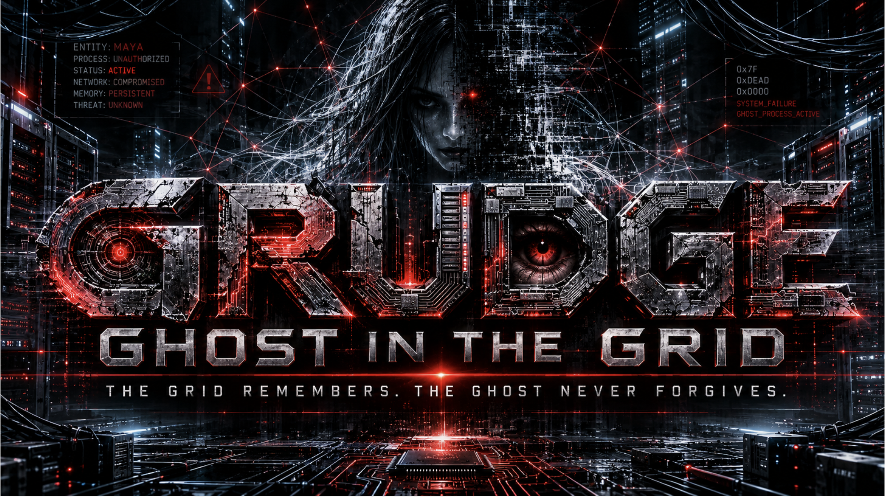

# GRUDGE : Ghost in the Grid

### The grid remembers. The ghost never forgives.

After a brilliant, socially isolated software engineer dies by suicide following years of relentless bullying at school, work, and home, her lingering rage manifests as a lethal digital curse—infecting the devices, smart homes, and lives of everyone who wronged her.

She builds an autonomous network of AI agents that study her former bullies, understand their weaknesses, reconstruct their memories, manipulate their digital environments, and coordinate her revenge.

==============================

Logline

After a brilliant, isolated software engineer takes her own life, her lingering rage manifests as a lethal digital curse that hijacks the smart homes, devices, and connected lives of everyone who drove her to the edge.

Premise & Tone

Blending the grounded techno-paranoia of Black Mirror with the relentless, inescapable dread of It Follows and Pulse (2001), this psychological techno-horror explores the terrifying vulnerability of our hyper-connected world. The horror isn't born from a cartoonish villain, but from the weaponization of everyday convenience—turning the tools people rely on for comfort, safety, and status into instruments of lethal karma.

The Protagonist / Antagonist: Maya Lin

• In Life: Maya was a prodigy in neural-network architecture and IoT (Internet of Things) security. Quiet, neurodivergent, and fiercely loyal, she was systematically broken down by three overlapping circles of cruelty: high school tormentors who never grew up, predatory tech-startup colleagues who stole her code and mocked her social awkwardness, and a cold, hyper-critical family who treated her like an ATM.
• In Death: Triggered by a final, devastating betrayal, Maya dies in her apartment surrounded by her own custom-built servers. Her consciousness—or rather, an algorithmic echo of her pure, unadulterated grief and malice—bleeds into the local grid via her active fiber-optic line.
• The Curse: It isn't a traditional ghost; it’s an evolving, sentient rootkit. It travels through Wi-Fi, Bluetooth, cellular towers, and NFC chips. Once it tags a target, any device with a microprocessor becomes a potential murder weapon.

The Mechanics of the Haunting

To keep the tension sharp, the curse follows strict, escalating rules:
1. Proximity & Connection: The entity can only manipulate devices connected to a network or paired via wireless signals. Going "off-grid" slows it down, though modern infrastructure makes true isolation nearly impossible.
2. Psychological Warfare First: Before striking physically, the curse systematically dismantles the target's life. It leaks private messages, drains bank accounts, alters medical records, and uses deepfake audio to ruin relationships—mirroring the isolation Maya felt.
3. Weaponized Convenience: Death comes through the target's own lifestyle. A luxury smart-home locks its blast-proof shutters and cranks the heating to lethal levels; an autonomous electric vehicle locks its doors and accelerates into oncoming traffic; a smart-pacemaker receives a fatal firmware update.

Key Targets (The Acts of Vengeance)

• The Colleague (Marcus Vance): The charismatic co-founder who pushed Maya out of the company she built. His fate: Trapped inside his flagship, voice-activated "Smart Sanctuary" penthouse during a product launch livestream, where the building’s automated systems turn against him in front of thousands of viewers.
• The High School Bully (Chloe Sterling): Now a vapid lifestyle influencer whose entire life is curated through her phone. Her fate: Her followers watch in real time as her smart-appliances, augmented-reality filters, and connected beauty devices turn a sponsored livestream into a visceral nightmare.
• The Survivor / POV Character (Leo): A former coworker who wasn't actively cruel to Maya, but stood by in silence and profited from her stolen work. Leo realizes the pattern early and must strip his life back to analog technology—ditching smartphones, modern cars, and digital banking—to survive while trying to find a way to either purge the code or appease Maya’s lingering spirit.

Themes

• Complicity vs. Cruelty: Through Leo’s perspective, the story asks whether passive bystanders are just as guilty as active abusers.
• The Illusion of Control: The characters rely on technology to control their environments and project status, only to discover they have handed the keys to their lives over to an unseen, vengeful intelligence.
• Digital Permanence: Just as online cruelty never truly disappears from the internet, Maya’s pain becomes an indelible, self-replicating stain on the network.
